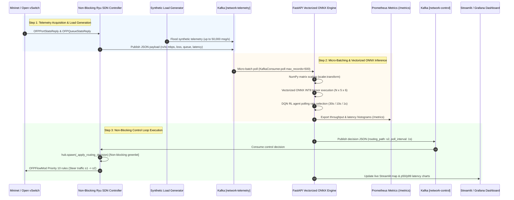

# Predictive Network Telemetry & Activation System Architecture

This document describes the high-throughput, sub-millisecond network control plane architecture for the **Predictive Network Telemetry & Activation System**.

---

## 1. High-Level Control Plane Overview

The architecture decouples network state acquisition, deep learning congestion forecasting, reinforcement learning polling control, and OpenFlow SDN routing using **Apache Kafka** as an event streaming backbone:

```
┌─────────────────────────────────────────────────────────────────────────┐
│                      SDN Network / Mininet Switches                     │
│    s3 (Aggregation 1) ──► s1 (Core Primary) ──► s4 (Aggregation 2)      │
│                  └──► s2 (Core Backup) ────┘                            │
└────────────────────────────────────┬────────────────────────────────────┘
                                     │ OpenFlow Port/Queue Stats & Echo Reply
                                     ▼
┌─────────────────────────────────────────────────────────────────────────┐
│                  Non-Blocking Ryu SDN Controller                        │
│         - Asynchronous Greenlet Worker Pools                            │
│         - Non-blocking OpenFlow Echo Latency Measurement                │
└────────────────────────────────────┬────────────────────────────────────┘
                                     │ Publish Telemetry Stream (JSON)
                                     ▼
┌─────────────────────────────────────────────────────────────────────────┐
│                 Apache Kafka Topic: [network-telemetry]                 │
│                 (High-Throughput 50,000+ events/sec)                    │
└────────────────────────────────────┬────────────────────────────────────┘
                                     │ Micro-Batch Poll (max_records=500, 5ms)
                                     ▼
┌─────────────────────────────────────────────────────────────────────────┐
│              FastAPI Vectorized ONNX Inference Microservice             │
│    - NumPy Matrix Feature Preprocessing                                 │
│    - Zero-Copy Tensor Inference (PyTorch / ONNX FP32 / INT8 Quantized)   │
│    - Stable-Baselines3 DQN Polling Action Selection                     │
│    - Prometheus Metrics Exporter (/metrics)                             │
└──────────────────┬─────────────────────────────────────┬────────────────┘
                   │                                     │
                   │ Publish Decisions                   │ Metrics Scrape
                   ▼                                     ▼
┌──────────────────────────────────────┐ ┌────────────────────────────────┐
│ Apache Kafka Topic: [network-control]│ │ Prometheus & Grafana / Dashboard│
└──────────────────┬───────────────────┘ └────────────────────────────────┘
                   │
                   │ Consume Decisions
                   ▼
┌─────────────────────────────────────────────────────────────────────────┐
│         Non-Blocking Ryu Controller -> Async Flow Rule Installation      │
│         (Priority 10 OpenFlow rules: reroute s1 -> s2 path)             │
└─────────────────────────────────────────────────────────────────────────┘
```

---

## 2. End-to-End Data Pipeline Sequence Diagram

The diagram below details the sequence of events from switch packet metrics to sub-millisecond self-healing flow redirection:



---

## 3. Data Schemas

### A. Telemetry Event Schema (`network-telemetry`)
```json
{
  "timestamp": 1770428945.1204,
  "switch_id": 3,
  "port_no": 1,
  "rx_mbps": 842.15,
  "tx_mbps": 839.80,
  "rx_loss": 0.0012,
  "tx_loss": 0.0008,
  "avg_queue_depth": 112,
  "latency_ms": 14.85
}
```

### B. Control Decision Schema (`network-control`)
```json
{
  "timestamp": 1770428945.1235,
  "switch_id": 3,
  "port_no": 1,
  "lstm_prob": 0.8842,
  "action_idx": 2,
  "polling_interval": 1,
  "routing_path": "s2",
  "engine": "onnx_quantized",
  "latency_ms": 0.054
}
```

---

## 4. Sub-Millisecond Non-Blocking Concurrency Architecture

1. **Vectorized Micro-Batching**: `FastAPI` consumes Kafka events via `consumer.poll(max_records=500, timeout_ms=5)`. Feature normalization uses NumPy matrix operations, avoiding Python single-row DataFrame overhead.
2. **Zero-Copy ONNX Inference**: Batch inputs are formatted as a single contiguous NumPy array (`N x 5 x 6`) and passed into ONNX Runtime `C++` execution providers.
3. **Async Eventlet Ryu Control**: Ryu controller greenlets handle Kafka consumption and dispatch flow rule updates (`OFPFlowMod`) using `hub.spawn()`. This ensures that OpenFlow message generation does not block telemetry reception or echo reply latency calculations.
