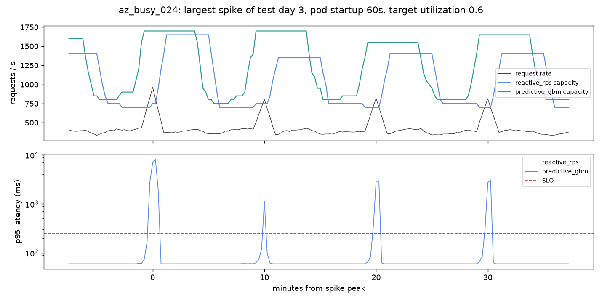

# Predictive Activation: Forecast-Driven Autoscaling

Autoscalers like the Kubernetes HPA react *after* load arrives, and new pods take 15 s to 3 min to become ready. This project forecasts the load a pod will face once it is ready and scales ahead of it, then measures whether that actually beats reactive scaling **at equal cost**.

It grew out of a CU Denver course project (CSCI 4930, team: Diego Alas, Gilberto Romero-Cano, Corey Green, JJ Wagner) that predicted congestion in an emulated SDN network. The streaming and inference stack from that project is still here; see [Origins](#origins-the-sdn-course-project).

[](https://github.com/GIlbertoRCP/Predictive_Activation/actions/workflows/ci.yml)

---

## Results

Policies are compared **at equal cost**: every policy runs at five target utilizations, which traces a cost-vs-SLO curve, and each policy's SLO-violation minutes are read off that curve at the pod-hours the reactive request-rate scaler spends at a 60% target. Forecasters train on 7 days; every policy is scored on the following 7. Full method and caveats: [AUTOSCALING.md](AUTOSCALING.md).

### Real traffic: Azure Functions 2019

12 HTTP-triggered apps from Microsoft's public [Azure Functions trace](https://github.com/Azure/AzurePublicDataset), chosen by a rule fixed in advance: the 8 busiest apps with traffic in at least 95% of minutes, plus the 4 burstiest of the rest. Each app is rescaled to a mean of 250 req/s. 6,300 simulated weeks in total; the table shows SLO-violation minutes per week at 60 s pod startup (mean of 3 Poisson seeds).

| App | Peak / mean | Reactive (request rate) | Naive-forecast control | **Hybrid (GBM + reactive floor)** | Change |
| :--- | ---: | ---: | ---: | ---: | ---: |
| `az_busy_002` | 1.4× | 0.0 | 0.0 | **0.0** | ≈ 0 |
| `az_busy_008` | 3.3× | 1.2 | 1.2 | **1.6** | ≈ 0 |
| `az_busy_016` | 2.9× | 0.2 | 0.3 | **0.3** | ≈ 0 |
| `az_busy_019` | 1.8× | 0.0 | 0.0 | **0.0** | ≈ 0 |
| `az_busy_022` | 2.6× | 5.8 | 5.8 | **1.6** | −73% |
| `az_busy_024` | 5.7× | 1331.2 | 1331.1 | 5.3 at +2% cost¹ | −99.6%¹ |
| `az_busy_033` | 5.3× | 54.2 | 54.2 | **1.9** | −96% |
| `az_busy_035` | 3.1× | 5.6 | 5.6 | **6.5** | +17% |
| `az_burst_090` | 40.6× | 142.2 | 142.3 | 69.2 at +5% cost¹ | −51%¹ |
| `az_burst_191` | 20.3× | 7.8 | 7.8 | **4.4** | −44% |
| `az_burst_075` | 35.0× | 24.5 | 24.5 | **24.6** | ≈ 0 |
| `az_burst_186` | 6.8× | 115.2 | 115.2 | **59.7** | −48% |

¹ Even at its leanest setting, the hybrid costs a little more than the reference here, so it can't be compared at exactly equal cost. The figure shown is its leanest point.



*`az_busy_024` gets a 4× burst for one minute every 10 minutes. The reactive scaler adds pods after each burst, too late to help. The forecaster learns the period and has them ready in time. (This app was hand-picked as the illustration.)*

### Synthetic traffic: flash crowds

**SLO-violation minutes per week at equal cost** (mean of 3 seeds):

| Pod startup | Kubernetes HPA (CPU) | Reactive (request rate) | Same controller, naive forecast | **Predictive (GBM q90)** | Change vs reactive |
| ---: | ---: | ---: | ---: | ---: | ---: |
| 15 s | 11.4 | 11.2 | 11.2 | **5.6** | −50% |
| 30 s | 25.9 | 21.5 | 21.6 | **10.7** | −50% |
| 60 s | 50.1 | 34.3 | 34.4 | **21.4** | −38% |
| 120 s | 87.6 | 49.9 | 50.1 | **38.8** | −22% |
| 180 s | 120.3 | 65.2 | 65.3 | **52.9** | −19% |

### What the experiments show

- **Forecasting pays off when load is predictable *and* changes faster than pods start.** On real traffic, the hybrid's big wins come from periodic bursts (cron-style jobs) and repeated bursty patterns. On real apps it beats the reactive scaler at equal cost in 22 of 60 (app, startup delay) combinations and loses in 2, both by under a minute. 28 are ties: smooth apps where there is nothing to win. In the other 8 it can't get down to the reference cost: at 1–15% more pod-hours it has 32–99.9% fewer violation minutes.
- **The gain comes from the forecast, not from scaling faster.** The naive-forecast control runs the same controller, with no scale-up rate limit, on a last-value forecast. It stays within about 1 violation minute of the reactive scaler in every case.
- **Use a hybrid, not a pure forecaster.** Tree models can't predict loads above anything in their training data. On apps whose test week runs busier than their training week, and on the synthetic `ramp`, the pure GBM under-provisions badly. Keeping the reactive recommendation as a floor removes those failures and keeps the gains.
- **The gain shrinks as pod startup grows**, against the usual pitch. Random spike onsets can't be seen minutes ahead; the forecaster mostly wins by spotting a spike that's already rising, or a repeating pattern.
- **CPU-based HPA is worst almost everywhere**, because CPU utilization caps at 100% and hides how overloaded a saturated service is.
- **An oracle with perfect foresight gets close to zero violations** at the same cost, so better forecasters still have room to improve.

Reproduce: `python -m predictive_activation.autoscale.evaluate` (synthetic, about 6 min on 16 cores) and `python -m predictive_activation.autoscale.evaluate --azure` (about 25 min, after the [data setup](AUTOSCALING.md#real-traffic-azure-functions-2019)). Raw results are in [benchmarks/autoscale/](benchmarks/autoscale/) and [benchmarks/autoscale_azure/](benchmarks/autoscale_azure/).

---

## Project Layout

```
src/predictive_activation/
  autoscale/
    traces.py          synthetic workload scenarios + Azure Functions 2019 loader
    simulator.py       cluster simulator: pod startup delay, backlog, M/M/c latency
    forecasters.py     last-value, seasonal-naive, Holt, GBM quantile, oracle
    policies.py        Kubernetes-HPA-style reactive, predictive, hybrid
    evaluate.py        experiment grid, equal-cost comparison, charts
  config.py            constants, paths, Kafka topics (single source of truth)
  models.py            LSTM / GRU forecasters
  data.py              dataset loading, labels, sliding windows
  service.py           FastAPI + Kafka inference service (InferenceEngine core)
  dashboard.py         Streamlit dashboard
  optimize.py          ONNX export, INT8 quantization, benchmarks
  replay_simulator.py  replays the CSV into Kafka
  stress_generator.py  synthetic Kafka load generator
  train/forecaster.py  trains the LSTM or GRU (--arch)
  train/rl_agent.py    trains the DQN polling agent
models/                trained checkpoints and ONNX graphs
data/                  recorded Mininet telemetry
benchmarks/            results.json (inference benchmarks), autoscale/ (experiment output)
legacy/sdn/            os-ken controller + Mininet topology (Linux only)
tests/                 pytest suite (no Kafka or Mininet needed)
```

---

## Running It

### 1. Setup

```bash
python -m venv .venv
source .venv/bin/activate        # Windows: .venv\Scripts\activate
pip install -e ".[dev]" --extra-index-url https://download.pytorch.org/whl/cpu
```

Use the `--extra-index-url` to get the CPU-only PyTorch build. Leave it out if you want CUDA.

### 2. Autoscaling experiments

```bash
python -m predictive_activation.autoscale.evaluate --quick   # ~20 s smoke run
python -m predictive_activation.autoscale.evaluate           # full grid, ~6 min on 16 cores
```

### 3. SDN pipeline, local simulation (any OS)

Mininet needs Linux kernel namespaces, so this mode replays recorded telemetry into the same streaming pipeline instead.

```bash
docker compose up -d kafka
python -m predictive_activation.service                      # FastAPI on :8000
python -m predictive_activation.replay_simulator --speed 2.0
streamlit run src/predictive_activation/dashboard.py
```

Open http://localhost:8501 and choose **Live Streaming & Self-Healing**. Or run everything in containers with `docker compose up --build`, then start the replay simulator against `localhost:9092`.

### 4. SDN pipeline, real network (Linux with Mininet + Open vSwitch)

```bash
pip install -e ".[sdn]"
python -m predictive_activation.service
os-ken-manager legacy/sdn/simple_switch_13.py legacy/sdn/predictive_controller.py
sudo python3 legacy/sdn/custom_topo.py
./legacy/sdn/traffic.sh
streamlit run src/predictive_activation/dashboard.py
```

### 5. Retrain the SDN models

```bash
python -m predictive_activation.train.forecaster --arch lstm
python -m predictive_activation.train.forecaster --arch gru
python -m predictive_activation.train.rl_agent
python -m predictive_activation.optimize          # writes benchmarks/results.json
```

### 6. Tests

```bash
ruff check src tests
pytest
```

CI runs both on every push and pull request.

---

## Dashboard Controls

* **Live engine swapping:** on the **MLOps & Edge Optimization** tab, switch between PyTorch, ONNX FP32 and ONNX INT8. The switch is a `/set-engine` call to the running service.
* **Congestion spike injection:** the sidebar button publishes to `network-simulation`. The replay simulator then injects 15 readings with latency above 150 ms, so you can watch the reroute to `s2`.

---

---

## Origins: the SDN course project

The original project predicted link congestion in a Mininet/Open vSwitch network and rerouted flows through a Kafka → FastAPI → os-ken control loop. It is preserved unchanged on the [`sdn-course-project`](https://github.com/GIlbertoRCP/Predictive_Activation/tree/sdn-course-project) branch; the cleaned-up version lives under `legacy/sdn/` and the shared package.

### SDN findings

All numbers come from [BENCHMARKS.md](BENCHMARKS.md), produced by `python -m predictive_activation.optimize` on a Ryzen 7 7700X.

| Finding | Number |
| :--- | :--- |
| LSTM next-step congestion F1 | 99.14% |
| Persistence baseline (next step = current step) | **99.30%**. The label changes on only 0.6% of steps, so the LSTM adds nothing here. |
| DQN polling agent vs a one-line threshold rule | 5,056 vs 4,990 mean reward (indistinguishable) |
| INT8 LSTM size | 792.6 KB → 210.6 KB (−73.4%) |
| INT8 reroute decisions matching FP32 | 99.92% of 24,909 windows |
| Batch-1 inference, PyTorch → ONNX Runtime | 0.22 ms → 0.054 ms (4.2×) |
| Per-event cost, batch 1 → batch 1024 (INT8) | 54 µs → 2.2 µs |

The streaming and inference engineering holds up. The prediction problem was too easy for the models to matter, which motivated the move to autoscaling.

### Original SDN architecture

The project implements a decoupled, event-driven streaming pipeline:

```
┌────────────────────────────────────────┐
│            SDN Control Plane           │
│     (Mininet Emulation & os-ken)       │
│                                        │
│          s3 ──► s1 ──► s4 (Primary)    │
│           └───► s2 ────┘  (Backup)     │
└──────────────────┬─────────────────────┘
                   │
                   │ Publish Telemetry (JSON)
                   ▼
┌────────────────────────────────────────┐
│            Apache Kafka                │
│    Topic: [network-telemetry]          │
└──────────────────┬─────────────────────┘
                   │
                   │ Consume Telemetry Stream
                   ▼
┌────────────────────────────────────────┐
│        FastAPI Inference Service       │
│    - Fits MinMaxScaler on CSV          │
│    - Runs PyTorch LSTM Forecasts       │
│    - Executes DQN RL Polling Decision  │
│    - Reroutes Path (s1 vs s2)          │
└──────────────────┬─────────────────────┘
                   │
                   │ Publish Control Commands (JSON)
                   ▼
┌────────────────────────────────────────┐
│            Apache Kafka                │
│     Topic: [network-control]           │
└──────────────────┬───────────────┬─────┘
                   │               │
                   │ Consume       │ Consume
                   ▼               ▼
┌───────────────────────────┐ ┌───────────────────────────┐
│     SDN Control Plane     │ │    Streamlit Dashboard    │
│  - Adjust Polling Rate    │ │  - Real-time Graphviz Map │
│  - Apply OpenFlow Rules   │ │  - Live Rolling Charts   │
│    to reroute flows       │ │  - Self-Healing Event Logs│
└───────────────────────────┘ └───────────────────────────┘
```

1. **Lightweight SDN Controller**: The os-ken controller polls OpenFlow switches for port/queue metrics, publishes raw telemetry to the `network-telemetry` topic, and subscribes to the `network-control` topic. It offloads all heavy ML calculations, keeping memory overhead under 30MB.
2. **Inference Microservice**: A FastAPI application consumes telemetry messages, maintains port-specific sliding windows, runs the LSTM to predict congestion, runs the DQN agent to select polling intervals, and decides when to reroute traffic from Core 1 (`s1`) to Core 2 (`s2`).
3. **Closed-Loop Self-Healing**: When the LSTM congestion forecast exceeds **70%**, the microservice commands the controller to:
   - Snaps the polling rate to intensive mode (1s).
   - Installs high-priority (priority 10) flow rules on aggregation switches to steer traffic flows to the backup path `s2` to prevent service degradation.
4. **Interactive Dashboard**: A Streamlit UI displays live metrics, plots throughput/latency/risk charts, lists self-healing logs, and visualizes the network topology in real-time.

---

## Tech Stack

| Layer | Technology |
|-------|-----------|
| Runtime | Python 3.12 |
| Event streaming | Apache Kafka (Confluent 7.5.0, KRaft mode) via Docker Compose |
| Service | FastAPI + Uvicorn, Prometheus client |
| Deep learning | PyTorch 2.10 (LSTM / GRU) |
| Reinforcement learning | Stable-Baselines3 DQN, Gymnasium |
| Inference optimization | ONNX, ONNX Runtime dynamic INT8 quantization |
| Dashboard | Streamlit, Altair, Graphviz |
| SDN (legacy) | os-ken 3.1.1, Mininet, Open vSwitch |

---

## License
MIT. See [LICENSE](LICENSE) for details.
